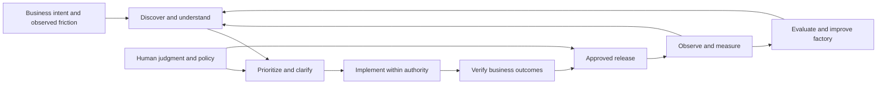

# ERP Factory

> **Your ERP should never be the bottleneck to business evolution.**

A research and engineering initiative for human-governed, continuously evolving enterprise software landscapes. We sell the ability to change enterprise software continuously — not cheaper people or cheaper code.

**Status:** v0.1 discovery and reference architecture. No production capability, SAP endorsement, live-system verification or customer commitment is claimed. SAP is the first execution ecosystem, not the limit of the vision. Integration and logistics are useful test cases, not the product boundary.

## North star

The factory covers the customer-owned, authorized change surfaces of ERP and connected systems: process improvement, configuration, custom extensions, integrations, upgrades, testing, performance, incident recovery, and ongoing application management. It never assumes permission to modify vendor-managed core code.

## Start here

The handbook captures the business hypothesis, evidence, architectural choices, skills, evaluations, customer onboarding, support and experimental roadmap. Documents are proposals until their associated proof is recorded.

- [Strategy and value proposition](docs/01-business-thesis.md)
- [Market and competition](docs/02-market-and-competition.md)
- [Architecture and evolution](docs/03-architecture.md)
- [Tenets and gates](docs/04-tenets.md)
- [Customer readiness and governance](docs/05-customer-readiness.md)
- [Skill and agent architecture](docs/06-skills-and-agents.md)
- [SAP landscape and execution](docs/07-sap-execution.md)
- [Benchmarks and evaluation](docs/08-evaluations.md)
- [Support and learning loops](docs/09-support-and-learning.md)
- [Customer discovery playbook](docs/10-discovery-playbook.md)
- [Experiments and decision roadmap](docs/11-roadmap.md)
- [Evidence and open questions](docs/12-evidence-register.md)
- [Visual atlas](docs/visual-atlas.md)

## How we work

- Mine first, ask only consequential questions, and explicitly identify unknowns.
- Prefer supported, least-invasive change placement and independently verify impact.
- Separate judgment, authorization and execution; never confuse model confidence with evidence.
- Keep business operations deterministic where possible; use agents for understanding, engineering and supervised evolution.
- Learn from failures and corrections through tested, versioned improvements.
- Preserve customer ownership, confidentiality, portability and exitability.

This public repository contains generalized knowledge only. Customer-specific data, requirements, credentials, contractual terms, internal contacts and operational evidence belong in an approved private customer workspace.

Do not interpret these documents as permission to access or change any SAP system. Validate applicable vendor terms, customer authorization, licensing and supported pathways before connecting tools.
